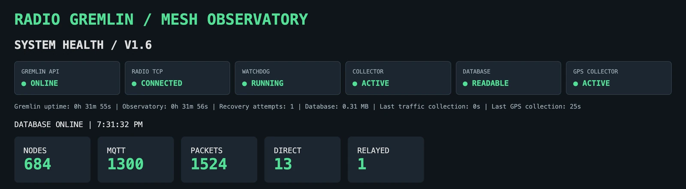
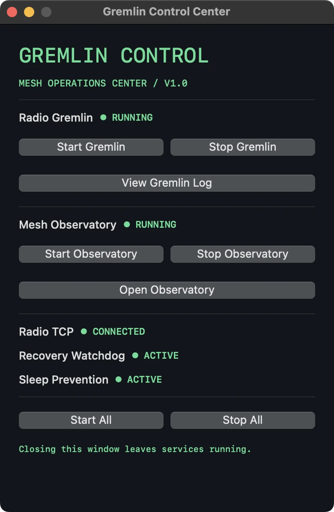
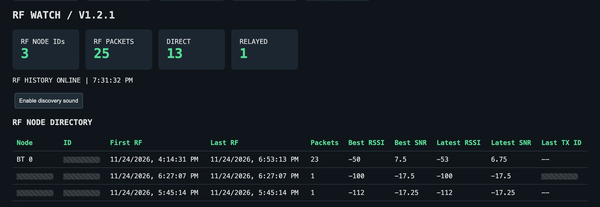
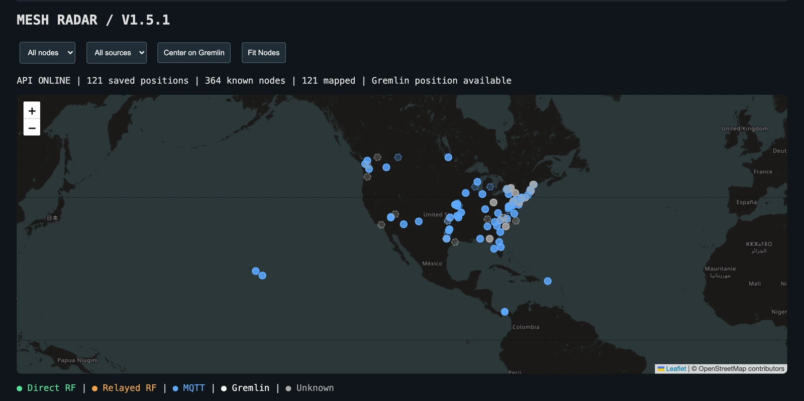

# Radio Gremlin

**A homemade mesh operations center for Meshtastic: a self-recovering mesh bot, a touchscreen
monitor, and a local observatory that keeps what your radio actually heard over RF separate from the
internet (MQTT) traffic.**

> ⚠️ **V0.1, Experimental Preview.** This is a personal workshop project, shared because people
> asked for it. It is not a finished product. It has been run by one person, on one setup, since
> 24 November 2026. Expect rough edges and breaking changes, and read [Security and privacy](#security-and-privacy)
> before you put anything on a network. No warranty; use at your own risk.

The story behind it: **[Radio Gremlin: How I Accidentally Built a Mesh Operations Center](https://badaudioguy.com/radio-gremlin-mesh-observatory/)**
on BadAudioGuy.com.



## What's in it

| Component | What it does |
|---|---|
| **Radio Gremlin** (patched [Meshing Around](https://github.com/SpudGunMan/meshing-around)) | The mesh bot. It talks to your radio over Wi-Fi/TCP and answers commands over RF, but never answers text that arrived via MQTT. |
| **Mesh Command API** (`gremlin/mesh_command.py`) | Read-only HTTP API running inside the bot: status, node list, recent traffic, positions. Local-only by default. |
| **Mesh Command** (`firmware/MeshCommand_CYD`) | ESP32 "Cheap Yellow Display" touchscreen monitor: live RSSI/SNR, node directory, traffic, system page. |
| **Mesh Observatory** (`gremlin/mesh_observatory.py`) | Local web dashboard with a persistent SQLite history: System Health, RF Watch, Mesh Radar map, RF Signal Analysis, Node Directory. |
| **Gremlin Watchdog** (`gremlin/gremlin_watchdog.py`) | Starts the bot, watches the radio's TCP link and restarts the bot after connection failures. |
| **Gremlin Control Center** (`macos/`, optional) | Native macOS window to start, stop and check everything, plus helper apps and a sleep-prevention agent. |

```
 LoRa mesh ──RF──> T-Beam radio ──Wi-Fi/TCP:4403──> Radio Gremlin bot (Meshing Around + patch)
                                                     ├─ Mesh Command API :8765 ──> Mesh Observatory :8766 ──> browser
                                                     │                        └──(LAN mode)──> Mesh Command CYD
                                                     └─ supervised by Gremlin Watchdog
```

## Hardware

- **A Meshtastic radio with Wi-Fi.** Developed with a **LilyGO T-Beam** running Meshtastic firmware,
  with Wi-Fi enabled so the TCP API (port 4403) is reachable on your network. Any Meshtastic node
  with the Wi-Fi/TCP API should work, but only the T-Beam has been tested.
- **A computer to run it.** Developed and tested on **macOS 13 (Ventura)** on an older iMac. The
  Python parts should also run on Linux (Meshing Around itself is developed on a Raspberry Pi), but
  that is **untested** for Radio Gremlin. The Control Center is macOS-only.
- **Optional:** an **ESP32-2432S028R "Cheap Yellow Display"** for Mesh Command. See
  [firmware/README.md](firmware/README.md).

Only one program can reliably hold a Meshtastic node's TCP API connection at a time. While Radio
Gremlin is running, don't connect the Meshtastic app or another client to the same radio over Wi-Fi.

## Software requirements

- Python 3.9 or newer (tested with 3.12), `git`, and `curl` (used by `status.sh`)
- Meshing Around's Python requirements (`meshtastic`, `PyPubSub` and others), installed
  automatically into a virtual environment
- An internet connection during install (to fetch Meshing Around and its packages), and in the
  browser for the Mesh Radar map tiles
- For the optional macOS apps: Xcode Command Line Tools (`xcode-select --install`)
- For the CYD: Arduino IDE 2 (or `arduino-cli`) with the ESP32 board package and three libraries.
  See [firmware/README.md](firmware/README.md).

## Install

```bash
git clone https://github.com/tonytheguitargeek-lab/Radio-Gremlin.git
cd Radio-Gremlin
./install.sh --radio 192.0.2.10        # your radio's IP (or IP:port); installs to ~/RadioGremlin
```

The installer:

1. clones Meshing Around and checks out the tested upstream commit
   (`897cc79`);
2. applies `meshing-around-patch/radio-gremlin.patch`;
3. copies in the Radio Gremlin components and the start/stop scripts;
4. creates `config.ini` (from Meshing Around's template) and `gremlin.ini` (from
   `config/gremlin.example.ini`);
5. creates a Python virtual environment and installs the requirements.

It **refuses to overwrite an existing install**. Use `--dir` to choose another location.

Then:

1. **Configure the bot:** edit `~/RadioGremlin/meshing-around/config.ini`. Under `[interface]`, set
   `type = tcp` and `hostname = <radio IP>` (done for you if you used `--radio`). Set your bot name,
   MOTD and which features to enable. See Meshing Around's documentation, and
   [config/meshing-around.example.ini](config/meshing-around.example.ini).
2. **Review `~/RadioGremlin/meshing-around/gremlin.ini`.** The defaults keep the API and Observatory
   on this computer only.

## Start, stop and status

```bash
~/RadioGremlin/scripts/start-gremlin.sh       # starts the Watchdog, which starts the bot when the radio is reachable
~/RadioGremlin/scripts/start-observatory.sh   # Mesh Observatory on http://127.0.0.1:8766
~/RadioGremlin/scripts/open-observatory.sh    # open the dashboard
~/RadioGremlin/scripts/status.sh              # what's running, radio link, API
~/RadioGremlin/scripts/view-log.sh            # follow the bot log

~/RadioGremlin/scripts/stop-observatory.sh
~/RadioGremlin/scripts/stop-gremlin.sh        # stops the Watchdog and the bot it started
```

The scripts only touch the processes of their own install, using pid files in `meshing-around/`.

Logs are written to `meshing-around/`:

- `watchdog-live.log`: Watchdog decisions (radio reachable, TCP healthy, recovery)
- `gremlin-live.log`: the bot's output
- `observatory-live.log`: Observatory errors

### Optional: macOS Control Center

```bash
./macos/install-macos-apps.sh                      # builds the apps into ~/RadioGremlin/apps
./macos/install-macos-apps.sh --sleep-prevention   # ...and keeps the Mac from sleeping while logged in
```

This builds **Gremlin Control Center** from Swift source and six small helper apps from AppleScript
source: Start/Stop Gremlin, Start/Stop Observatory, Open Observatory and Gremlin Log. Nothing is
shipped precompiled. "Open Observatory" uses Google Chrome's app mode if Chrome is installed,
otherwise your default browser.



## Mesh Command CYD and LAN access

The CYD is a separate device on your Wi-Fi, so it needs the API to be reachable over the LAN.
**That is off by default.**

1. In `meshing-around/gremlin.ini`, set `[api] bind` to this computer's LAN IP address, for example
   `bind = 192.0.2.20`. Keep `[observatory]` as it is.
2. Restart: `stop-gremlin.sh`, then `start-gremlin.sh`. On macOS, allow Python to accept incoming
   connections if the firewall asks.
3. Put `http://<that address>:8765` in the CYD's `secrets.h` and flash it. See
   [firmware/README.md](firmware/README.md), which also covers the **required TFT_eSPI setup**.

> 🔓 **The LAN API is unauthenticated.** In LAN mode, anyone on your network can read `/status`,
> `/nodes` and `/traffic` over plain HTTP. `/traffic` includes the text of broadcast channel
> messages; direct messages are hidden. Node positions (`/mapnodes`) stay restricted to the computer
> itself. Use LAN mode only on a network you trust, and never expose port 8765 to the internet.
> Details: [SECURITY.md](SECURITY.md).

## RF vs. MQTT

Through MQTT, a Meshtastic node can see traffic from far beyond its radio range. Radio Gremlin keeps
**what your radio heard over the air** (with your RSSI/SNR, direct or relayed) separate from traffic
that arrived via MQTT. The bot **never replies to MQTT text messages**.

That rule lives in the bot. Your **radio firmware** may still forward MQTT downlink traffic over LoRa,
depending on your MQTT and channel settings. Read **[docs/MQTT-vs-RF.md](docs/MQTT-vs-RF.md)** before
connecting an internet-linked node to your local mesh.




## Security and privacy

- **The API and Observatory listen on `127.0.0.1` by default.** LAN mode for the CYD exposes an
  unauthenticated, read-only API (see above).
- **`observatory.db` stores other people's node IDs, names, signal reports and reported positions.**
  Keep it private. It is git-ignored.
- **Keep secrets out of commits.** CYD Wi-Fi credentials go in the git-ignored `secrets.h`. Your
  `config.ini` and `gremlin.ini` are git-ignored too.
- **The Observatory map makes outside requests,** loading Leaflet from unpkg.com and tiles from
  OpenStreetMap.

See [SECURITY.md](SECURITY.md).

## Troubleshooting

| Symptom | Things to check |
|---|---|
| Watchdog log says `Radio unavailable - waiting` | The radio's IP in `config.ini` (`[interface] hostname`); the radio is on Wi-Fi; your network allows ping (the Watchdog checks reachability with ICMP ping before starting the bot). |
| `TCP connection missing 1/3` … `recovery required` | Another client (e.g. the Meshtastic app over Wi-Fi) is holding the radio's TCP connection; the radio rebooted; weak Wi-Fi at the radio. The Watchdog will keep retrying. |
| `Connection error detected in Gremlin log`, then a restart | Normal recovery after a dropped connection. If it repeats constantly, check the radio's Wi-Fi signal and power. |
| `status.sh` shows the API offline | The bot isn't running yet (the Watchdog waits for the radio), or the API port is in use. Check `gremlin-live.log` for `Mesh Command V1.4 online`. |
| Observatory says `Address already in use` | Another program (or another install) is using port 8766. Change `[observatory] port`. |
| Mesh Radar is blank: "Map library unavailable" | The browser needs internet access to load Leaflet and the map tiles. |
| CYD shows `API OFFLINE` | LAN mode isn't enabled (API still on 127.0.0.1); wrong `MESH_COMMAND_URL`; macOS firewall blocking Python; the CYD is on a different network or 5 GHz Wi-Fi (the ESP32 only supports 2.4 GHz). |
| CYD screen white, mirrored or wrong colors | TFT_eSPI isn't configured for the CYD, or your board is a different CYD variant. See [firmware/README.md](firmware/README.md). |
| CYD touch is off-target | System page → **CALIBRATE TOUCH**. |
| macOS: "app can't be opened" | The apps are built and ad-hoc signed locally. Right-click → **Open** the first time. |
| `install.sh` refuses to run | The target already has `meshing-around/`. Use `--dir` for a fresh location. |

## What has been tested (V0.1)

Tested on macOS 13 (Ventura) with Python 3.12, Meshing Around `897cc79` and the meshtastic Python
library installed by `install.sh`, against a **simulated Meshtastic radio** that speaks the real TCP
protocol:

- a clean install from GitHub and PyPI;
- bot startup;
- RF replies, and **no replies to MQTT**;
- API classification and access rules;
- all Observatory views;
- watchdog recovery from a dropped and a missing radio;
- the start, stop and status scripts;
- the CYD firmware compiling for the ESP32 (core 3.3.12);
- building the macOS apps.

The author's own install has been running with a LilyGO T-Beam since 24 November 2026, and has
already recovered from a real dropped connection unattended.

**Not tested yet:**

- **Linux and Raspberry Pi:** the scripts use `lsof` and `ping`, and the macOS apps are macOS-only.
- **Other radios:** anything other than a T-Beam, and a fresh install against a real radio. The
  release itself was tested against the simulated radio.
- **The CYD firmware on hardware:** it was compiled for this release, but not flashed onto a board
  from this repository.
- **The Control Center and helper apps in use:** they were built and inspected, but not clicked
  through.
- **Other library versions:** newer meshtastic or Meshing Around versions than the ones above.
- **Long-term unattended operation** (weeks).

Reports from other setups are welcome. Please include your OS, radio and firmware version.

## Uninstall

Run `stop-observatory.sh` and `stop-gremlin.sh`, then delete the install folder (`~/RadioGremlin` by
default). If you installed sleep prevention, also run
`launchctl unload ~/Library/LaunchAgents/com.radiogremlin.caffeinate.plist` and delete that file.

## Credits

- **Radio Gremlin** by **[Bad Audio Guy](https://badaudioguy.com)**, a broadcast engineer, with
  AI-assisted development using **ChatGPT ("Scout")** and **Claude ("the Nerd")**.
- Built on **[Meshing Around](https://github.com/SpudGunMan/meshing-around)** by **Kelly Keeton,
  K7MHI (SpudGunMan)** and contributors (GPLv3). Radio Gremlin's changes to it are in
  `meshing-around-patch/` and listed in [NOTICE.md](NOTICE.md).
- Mesh Command uses TFT_eSPI (Bodmer), XPT2046_Touchscreen (Paul Stoffregen) and ArduinoJson
  (Benoît Blanchon). Mesh Radar uses Leaflet and © OpenStreetMap contributors.

Meshtastic® is a registered trademark of Meshtastic LLC. Radio Gremlin is an independent project,
not affiliated with or endorsed by Meshtastic LLC, LilyGO or the Meshing Around project.

## License

**GNU General Public License v3.0.** See [LICENSE](LICENSE). Upstream copyright notices are preserved,
and the modifications to Meshing Around are marked in the patch. Third-party notices:
[NOTICE.md](NOTICE.md).
